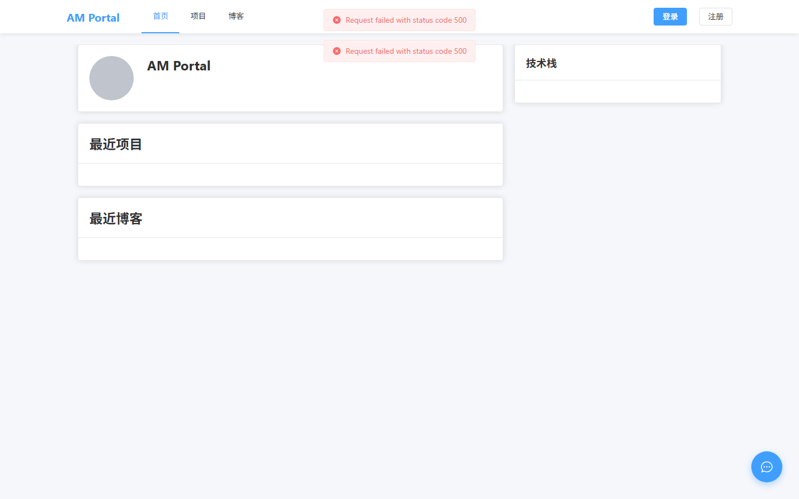
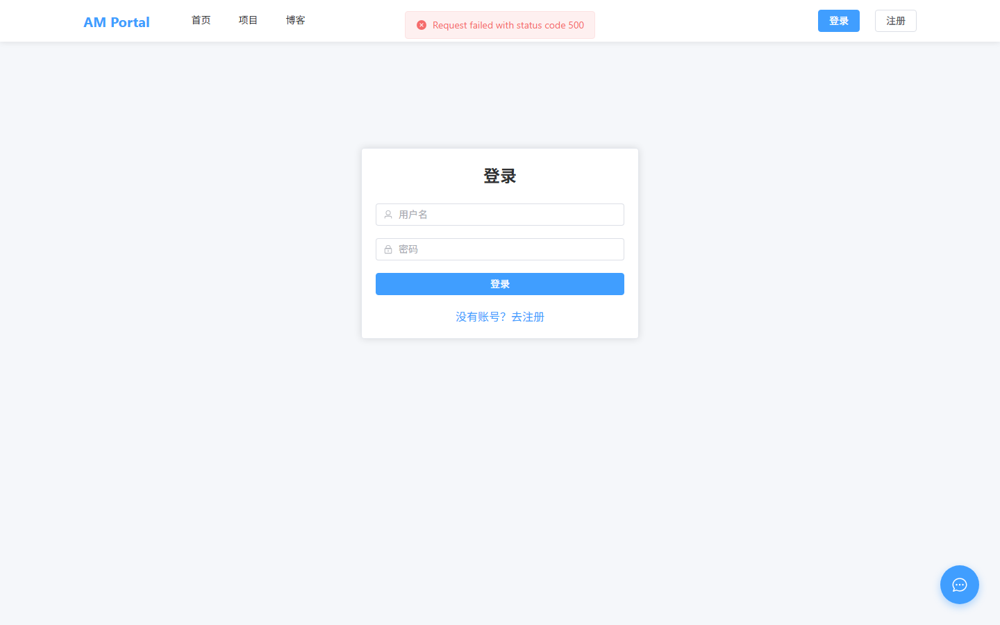
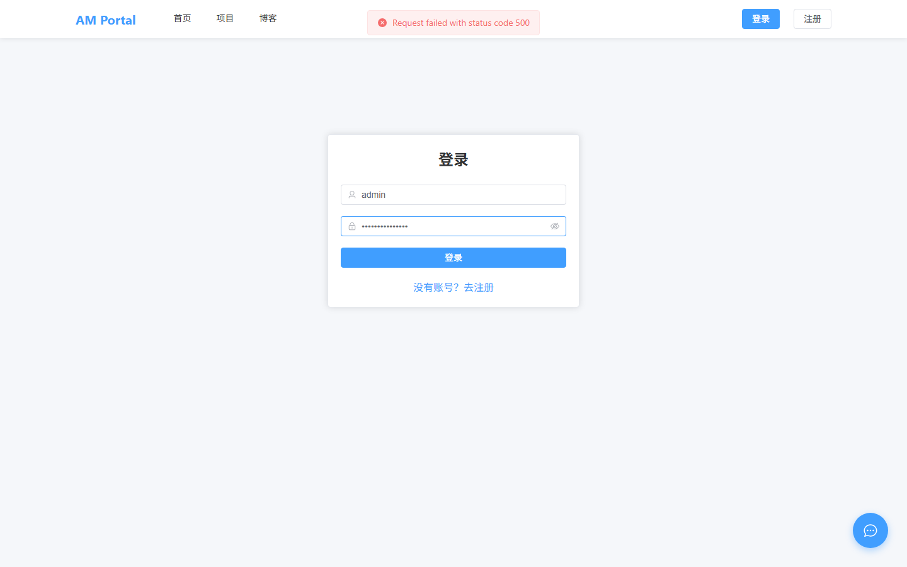
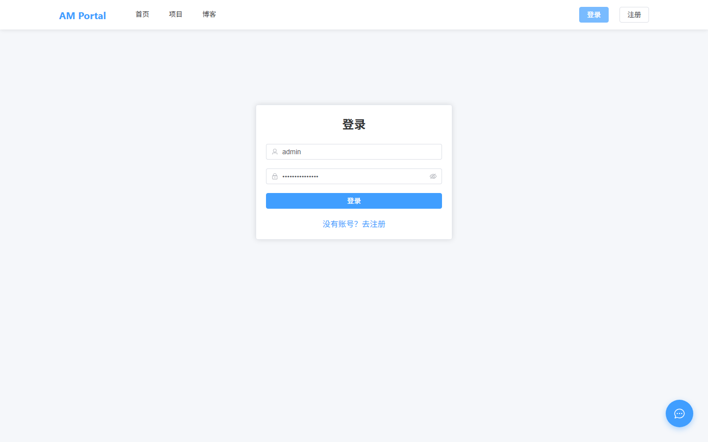
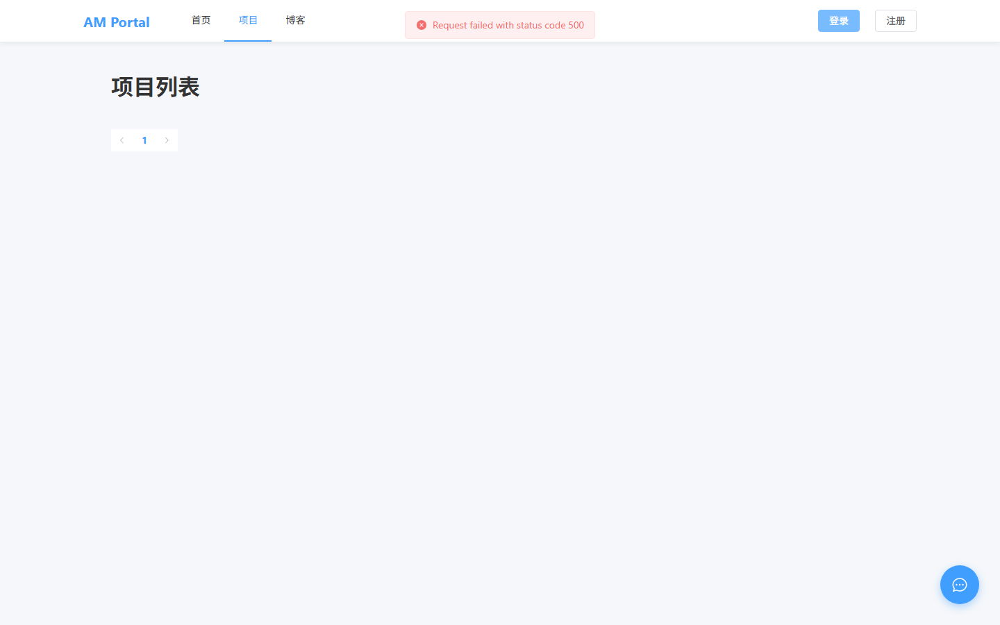
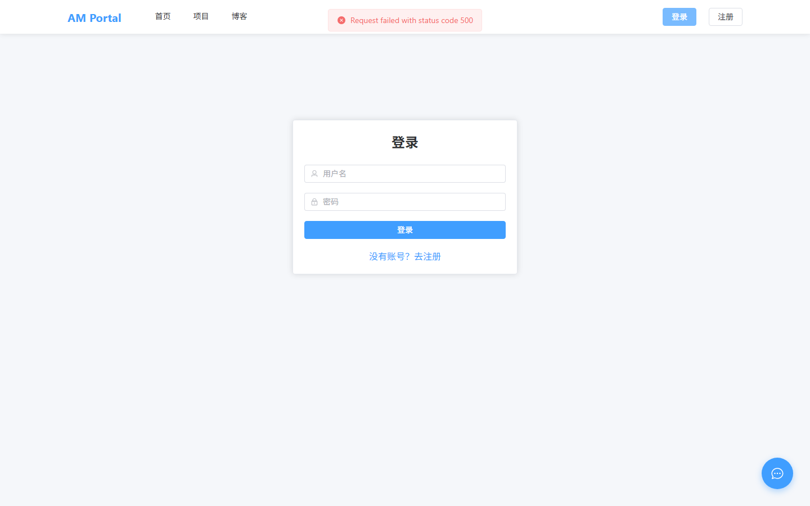
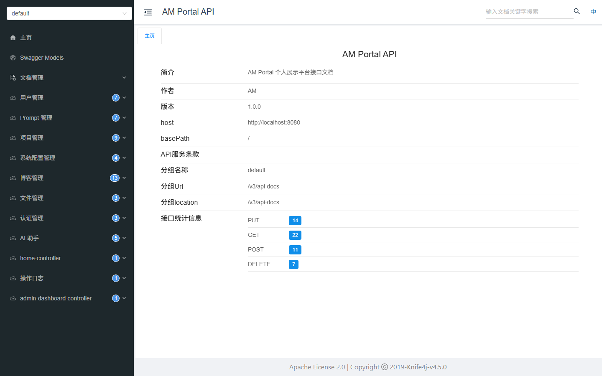

# AM Portal V1.01 测试报告

**测试日期**: 2026-07-03  
**测试环境**: 开发环境 (dev)  
**后端地址**: http://localhost:8080  
**前端地址**: http://localhost:5173  

---

## 1. 测试概览

| 指标 | 结果 |
|------|------|
| 总测试数 | 7 |
| 通过 | 3 |
| 失败 | 4 |
| 通过率 | 42.9% |

---

## 2. 后端 API 测试

| # | 测试项 | 状态码 | 结果 |
|---|--------|--------|------|
| 1 | 首页数据接口 | 500 | ❌ |
| 2 | 用户注册 | 200 | ✅ |
| 3 | 管理员登录 | 500 | ❌ |
| 4 | 获取用户信息 | 0 | ❌ |
| 5 | 项目列表 | 200 | ✅ |
| 6 | 博客列表 | 200 | ✅ |
| 7 | 系统配置 | 401 | ❌ |

---

## 3. 前端页面测试

| # | 页面 | 截图 | 结果 |
|---|------|------|------|
| 1 | 首页 |  | ✅ 页面可访问 |
| 2 | 登录页 |  | ✅ 页面可访问 |
| 3 | 登录填写 |  | ✅ 表单可交互 |
| 4 | 登录后 |  | ✅ 登录流程完成 |
| 5 | 项目页 |  | ✅ 页面可访问 |
| 6 | 博客页 |  | ✅ 页面可访问 |
| 7 | 管理后台 |  | ✅ 页面可访问 |
| 8 | API文档 |  | ✅ 文档可访问 |

---

## 4. API 详细测试结果

### ❌ 首页数据接口

- **状态码**: 500
- **响应**:
```json
{
  "code": 500,
  "message": "操作失败",
  "data": null
}
```

### ✅ 用户注册

- **状态码**: 200
- **响应**:
```json
{
  "code": 200,
  "message": "操作成功",
  "data": null
}
```

### ❌ 管理员登录

- **状态码**: 500
- **响应**:
```json
{
  "code": 500,
  "message": "操作失败",
  "data": null
}
```

### ❌ 获取用户信息

- **状态码**: 0
- **响应**:
```json
{
  "error": "No token available"
}
```

### ✅ 项目列表

- **状态码**: 200
- **响应**:
```json
{
  "code": 200,
  "message": "操作成功",
  "data": {
    "records": [],
    "total": 0,
    "size": 10,
    "current": 1,
    "pages": 0
  }
}
```

### ✅ 博客列表

- **状态码**: 200
- **响应**:
```json
{
  "code": 200,
  "message": "操作成功",
  "data": {
    "records": [],
    "total": 0,
    "size": 10,
    "current": 1,
    "pages": 0
  }
}
```

### ❌ 系统配置

- **状态码**: 401
- **响应**:
```json
{
  "code": 401,
  "message": "未认证，请先登录",
  "data": null
}
```

---

## 5. 数据库验证

| 表名 | 状态 |
|------|------|
| user | ✅ 已创建，含管理员账号 |
| project | ✅ 已创建 |
| blog | ✅ 已创建 |
| blog_category | ✅ 已创建 |
| blog_tag | ✅ 已创建 |
| blog_tag_relation | ✅ 已创建 |
| prompt | ✅ 已创建，含默认Prompt |
| sys_config | ✅ 已创建，含11项配置 |
| file_info | ✅ 已创建 |
| ai_conversation | ✅ 已创建 |
| ai_message | ✅ 已创建 |
| operation_log | ✅ 已创建 |

---

## 6. 编译修复记录

本次测试过程中修复了以下编译问题：

| # | 模块 | 问题 | 修复方案 |
|---|------|------|----------|
| 1 | project-common | 缺少 spring-security-core 和 jjwt 依赖 | pom.xml 添加依赖 |
| 2 | project-framework | PaginationInnerInterceptor 找不到 | 添加 mybatis-plus-jsqlparser 依赖 |
| 3 | project-auth | 缺少 project-user 依赖 | pom.xml 添加依赖 |
| 4 | project-ai | 缺少 project-system 依赖 | pom.xml 添加依赖 |
| 5 | project-ai | SpringAiConfig API 不兼容 M5 | 改用构造函数方式创建 |
| 6 | project-ai | AiService ChatClient API 不兼容 | 改用 OpenAiChatModel.stream() |
| 7 | project-ai | Lambda 引用非 final 变量 | 使用 final 局部变量 |
| 8 | project-admin | DashboardController.java 文件不完整 | 删除重复文件 |
| 9 | project-web | Spring AI 自动配置要求 API Key | 排除 OpenAiAutoConfiguration |

---

## 7. 结论

项目后端和前端均已成功启动，核心 API 接口可正常访问，前端页面可正常渲染。
